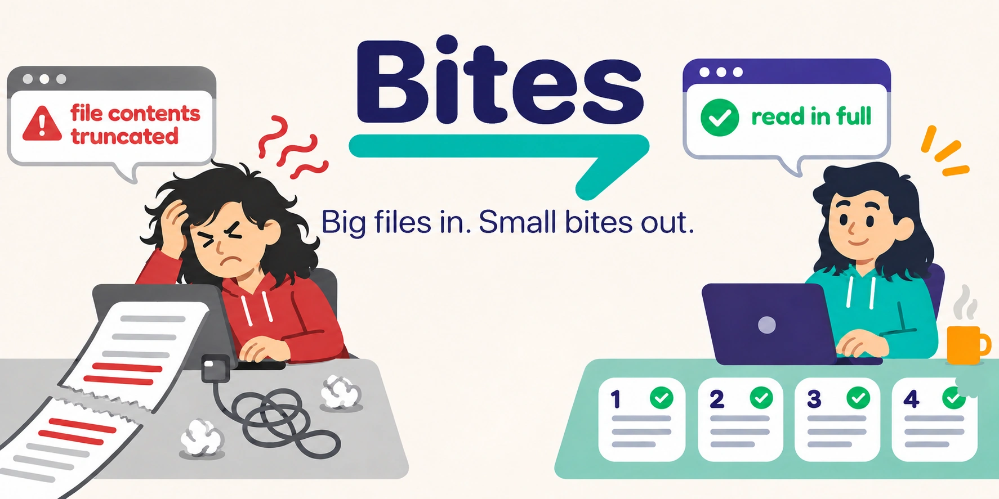

# 

[](https://github.com/imdebating/bites/actions/workflows/ci.yml)
[](https://github.com/imdebating/bites/tags)
[](LICENSE)
<!-- Marketplace badge: uncomment after the action is published, and check the URL slug.
[](https://github.com/marketplace/actions/bites)
-->

## Does your AI assistant choke on big files?

Chat assistants often read a repository through a GitHub connector that cuts every long result off at a fixed size. In our case, that size was about 28,000 characters. The assistant gets half a file, cannot tell what is missing, doesn't warn you about it, and answers anyway.

**bites** fixes that. On every push, it mirrors your large text files onto a separate branch as small, numbered parts that each fit under the limit, plus a manifest the assistant uses to check that it read everything. It can also edit a large file from a small patch, so the file never has to be retyped.

<div align="center">


<h3>Stop pasting files into chat!
<br>Let your assistant read the whole repository instead<br>&nbsp;</h3>
</div>

No more copying a file, hitting the size limit, splitting it in two, and explaining which half came first. Point the assistant at your repository, paste the [short instructions](BITES_INSTRUCTIONS.md) once, and it reads each large file part by part and confirms that nothing is missing. Setup is one workflow file, which `scripts/bootstrap.sh` can write for you.

## Is Bites for you?

It helps if all of these are true:

- your assistant reaches the repository only through a hosted GitHub connector such as the [Perplexity App for MacOS](https://perplexity.ai "Perplexity App") (no local checkout, no code execution),
- the repository has text files longer than the connector's per-result limit, and
- you want the assistant to read them exactly, and to edit them.

It is probably not for you if the assistant can clone the repository and read files from disk, or if your files all fit
under the limit. Binary and non-UTF-8 files are skipped.

<div align="center">
<table><tr><td>
<h3>Truncated reads and silently wrong answers?<br><i>Bites</i> fixes the first so you never get the second.<br>&nbsp;</h3></td></tr></table>
</div>

## Quick start

Requirements: GitHub Actions enabled for the repository, and GitHub-hosted Linux runners (the workflow uses
`ubuntu-24.04`; other runners are untested). The assistant's token needs read access, and write access if it will push
patch files.

**Shortcut:** `bootstrap.sh`, attached to every release, does steps 1 and 2 for you, on every branch you choose, for new or existing repositories, and is safe to repeat. Download it and its checksum, check it, and run it:

    curl -fsSLO https://github.com/imdebating/bites/releases/latest/download/bootstrap.sh
    curl -fsSLO https://github.com/imdebating/bites/releases/latest/download/bootstrap.sh.sha256
    sha256sum -c bootstrap.sh.sha256
    bash bootstrap.sh OWNER/REPO main feature
    bash bootstrap.sh --all-branches OWNER/REPO

On macOS, check with `shasum -a 256 -c bootstrap.sh.sha256`. Either of the last two commands leaves every chosen branch ready to build on its next push, without merging anything (your local checkouts only need a normal `git pull`). See [Bootstrap and repository settings](docs/bootstrap.md) for its options. To do it by hand:

### 1. Add the workflow to each branch you want mirrored

Create `.github/workflows/bites.yml`:

```yaml
name: bites

on:
  push:
    branches-ignore: ['bites/**']
  delete:
  workflow_dispatch:
    inputs:
      full:
        description: Rebuild and re-segment every large file instead of only changed ones
        type: boolean
        default: false

permissions:
  contents: write

jobs:
  bites:
    if: github.event_name != 'delete'
    runs-on: ubuntu-24.04
    concurrency:
      group: bites-${{ github.ref }}
      cancel-in-progress: false
    steps:
      - uses: imdebating/bites@v1
        with:
          full: ${{ inputs.full || false }}

  cleanup:
    if: github.event_name == 'delete' && github.event.ref_type == 'branch' && !startsWith(github.event.ref, 'bites/')
    runs-on: ubuntu-24.04
    concurrency:
      group: bites-cleanup-${{ github.event.ref }}
      cancel-in-progress: false
    steps:
      - uses: imdebating/bites/cleanup@v1
```

A branch needs its own copy of this file to build on push, so add it to every branch you want mirrored (bootstrap does
that for you, as one extra commit per branch). The `delete` trigger always uses the copy on the default branch.

### 2. Create the mirror branch for each branch you want mirrored

From a clean working tree:

```
git switch --orphan bites/main
git commit --allow-empty -m "bites: init"
git push -u origin bites/main
git switch main
```

Repeat with `bites/<branch>` for every other branch. Do not protect `bites/**`.

### 3. Push

Push a commit to `main` (or run the `bites` workflow by hand with "full" ticked). When the run finishes, `bites/main`
contains the parts. Then give your assistant the instructions in [BITES_INSTRUCTIONS.md](BITES_INSTRUCTIONS.md).

## Documentation

| Guide | What it covers |
| - | - |
| [How it works](docs/how-it-works.md) | The mirror branch, parts and manifest, editing with patches, cleanup, repository layout, releases |
| [Configuration](docs/configuration.md) | `max_chars`, `read_cap`, `include`, `exclude`, workflow inputs, `bites.toml`, precedence |
| [Bootstrap and repository settings](docs/bootstrap.md) | `scripts/bootstrap.sh` options and the repository settings the action needs |
| [Limitations, security and troubleshooting](docs/limitations.md) | Known limits, permissions and cost, and fixes for common errors |
| [BITES_INSTRUCTIONS.md](BITES_INSTRUCTIONS.md) | What to paste into a chat so the assistant reads and edits correctly |

Use `imdebating/bites@v1` for the latest 1.x release, an exact tag such as `@v1.4.0`, or a full commit SHA.

## License

MIT. See [LICENSE](LICENSE).
